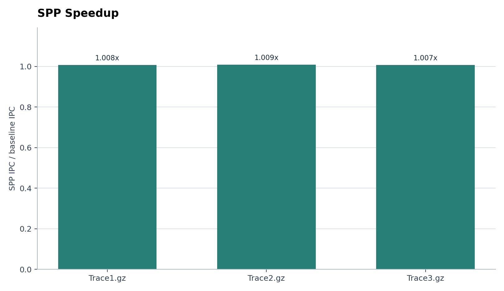
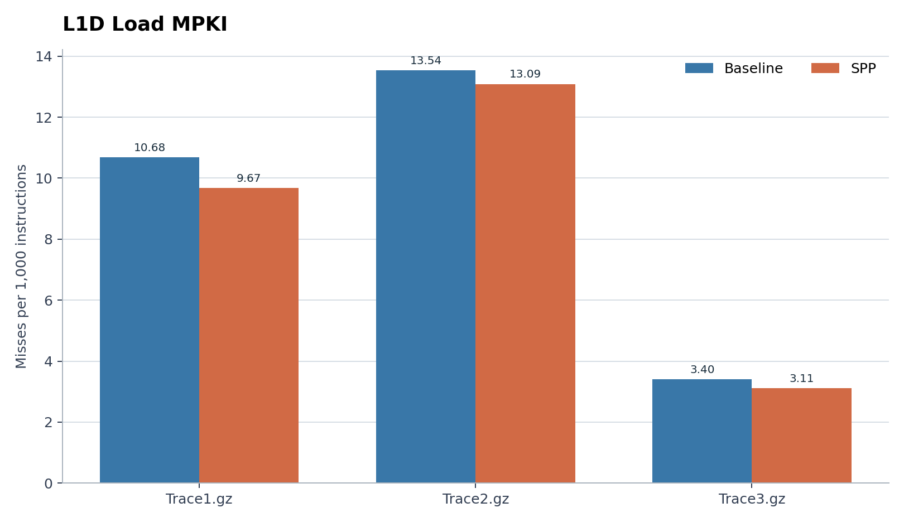
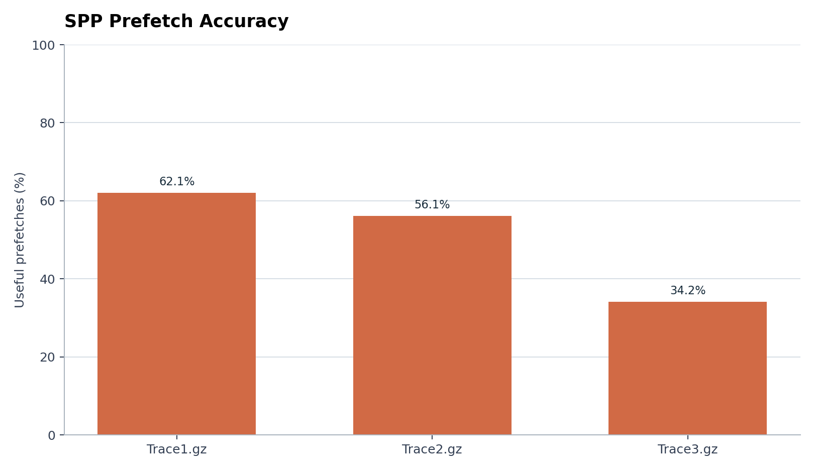
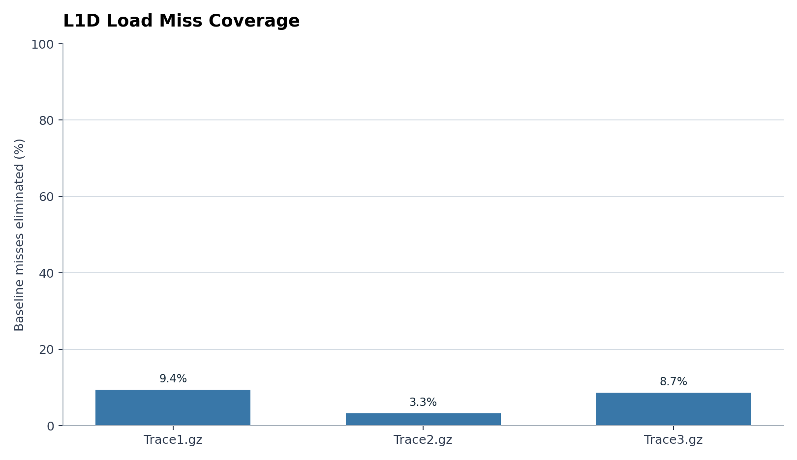

# Task 1: Stride Pattern Prefetcher (SPP)

## 1) IPC, Speedup, L1D Load MPKI, Prefetch Accuracy, and Coverage

The table below reports the values obtained for the three traces.

| Trace | IPC with Prefetcher | Speedup | L1D Load MPKI | Prefetch Accuracy | Coverage |
|---|---:|---:|---:|---:|---:|
| Trace1.gz | 0.233918 | 1.00778x | 9.67160 | 62.0792% | 9.43% |
| Trace2.gz | 0.252293 | 1.00924x | 13.08920 | 56.0933% | 3.31% |
| Trace3.gz | 0.384546 | 1.00701x | 3.10912 | 34.1697% | 8.65% |

The SPP metrics were collected by rerunning the prefetcher on all three traces.

### Speedup

### L1D load MPKI

### Prefetch accuracy

### Coverage

## 2) Storage overhead of the prefetcher

The prefetcher uses two main tables:

### IP tracker table
Each entry of `IP_Tracker` contains:

- `ip` = 64 bits
- `last_addr` = 64 bits
- `last_stride` = 64 bits
- `uniform_conf` = 32 bits
- `signature` = 16 bits
- `lru_rank` = 8 bits

Logical field width:

- 64 + 64 + 64 + 32 + 16 + 8 = 248 bits

There are 128 entries:

- 128 × 248 = 31,744 bits

### Pattern table
Each entry of `Pattern_Entry` contains:

- `signature` = 16 bits
- `next_stride` = 64 bits
- `lru_rank` = 8 bits

Logical field width:

- 16 + 64 + 8 = 88 bits

There are 256 entries:

- 256 × 88 = 22,528 bits

LRU uses stack ranks: rank 0 is most recently used, and the largest rank is selected for eviction. Each rank field is `uint8_t`; the 256-entry pattern table uses ranks 0 through 255.

### Total storage overhead

- IP tracker table: 31,744 logical bits
- Pattern table: 22,528 logical bits
- Prefetch tracking array: 64 × 64 = 4,096 bits

Total logical field storage per core:

- 31,744 + 22,528 + 4,096 = 58,368 bits (7,296 bytes)

These logical bit counts exclude C++ struct padding. With the current field order and typical 8-byte alignment, `sizeof(IP_Tracker)` is 32 bytes and `sizeof(Pattern_Entry)` is 24 bytes; including the 4,096-byte IP table, 6,144-byte pattern table, and 512-byte prefetch tracking array, the allocated arrays occupy about 10,752 bytes per core.

## 3) Threshold for accuracy throttling

We chose the accuracy thresholds to be 0.75 and 0.40. The prefetcher increases its degree only when more than 75% of recent prefetches are useful, and it backs off when usefulness drops below 40%. Keeping a gap between these two points makes the control more stable, so the prefetcher does not keep flipping between aggressive and conservative behavior.

These values were picked after trying different cutoffs and comparing IPC, L1D MPKI, and prefetch usefulness across the traces. The final pair gave the best balance between better coverage and lower cache pollution. It lets the prefetcher stay aggressive when the pattern is working but back off quickly when it starts generating useless fills.

## 4) Why these prefetch degrees were chosen

The prefetcher starts with a degree of 2 and then adjusts itself by one step at a time based on how useful the recent prefetches actually are.

- If accuracy is above 75%, the degree is increased by 1 to improve coverage.
- If accuracy falls below 40%, the degree is decreased by 1 to avoid useless prefetches.

This starting value was chosen because it is a good middle ground: it is high enough to help when the access pattern is regular, but not so aggressive that it pollutes the cache on noisy or irregular streams. Uniform stride patterns can benefit from a slightly higher degree, while non-uniform or unstable patterns are better handled with a smaller degree. So the degree of 2 keeps the design conservative at first, and the accuracy-based throttling then decides whether to increase or decrease the aggressiveness by exactly 1 step at a time, with the degree bounded between 1 and 4.
